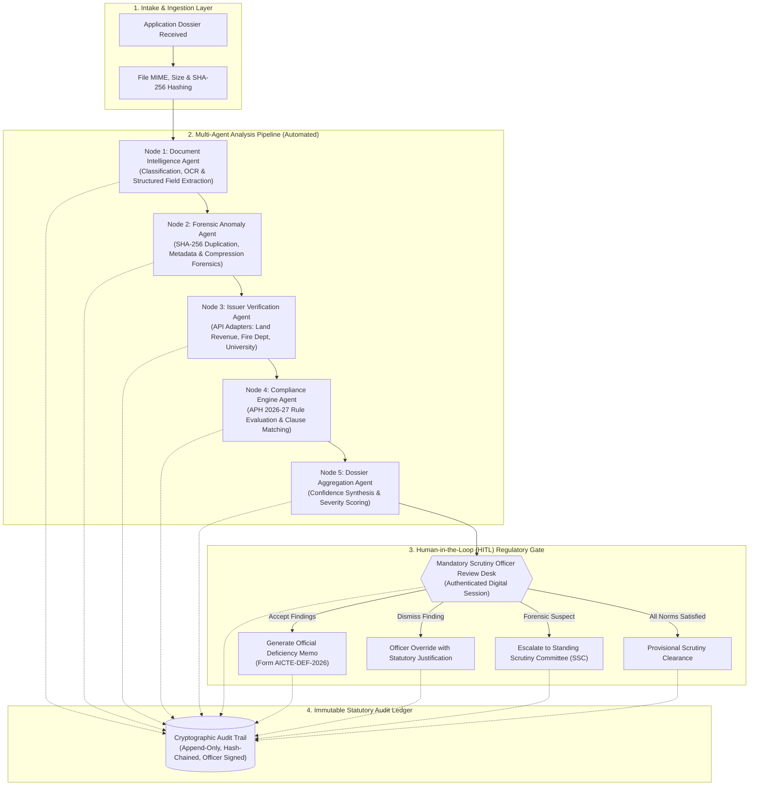
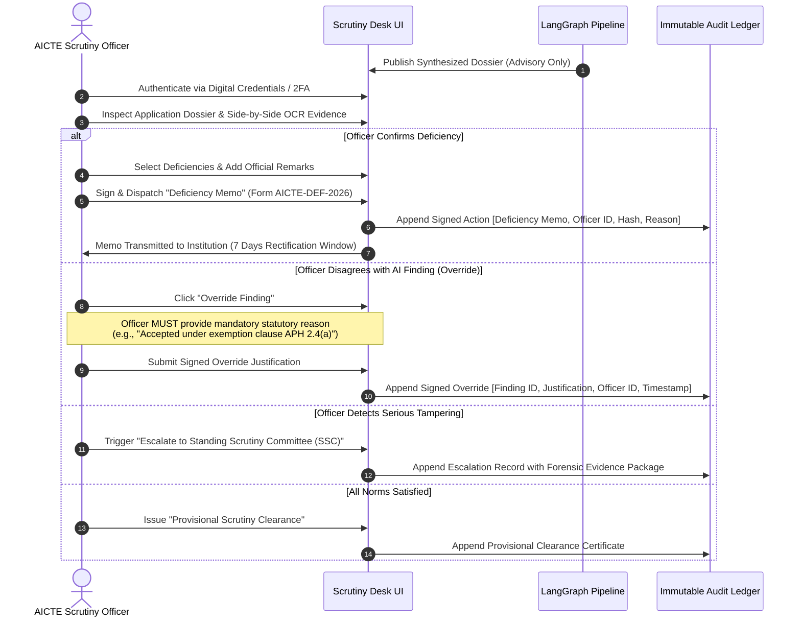

# AICTE Multi-Agent Verification Architecture & Human-in-the-Loop (HITL) Governance
## Statutory Workflow, LangGraph Orchestration & Decision Protocol (`AGENT_WORKFLOW.md`)

---

## 1. Statutory Philosophy & Guiding Principles

The **AICTE Application Validation and Regulatory Compliance Platform** employs a multi-agent artificial intelligence system strictly designed as a **Decision-Support and Scrutiny Assistance Layer**. 

### Core Statutory Mandates
1. **Advisory Sovereignty**: The AI agents **never** issue final regulatory decisions (rejections or approvals). Statutory authority remains exclusively vested in designated AICTE Scrutiny Officers, Regional Officers, and the Standing Scrutiny Committee (SSC).
2. **Deficiency vs. Anomaly Distinction**:
   - A missing document or expired validity is categorized as a **Validation Finding / Regulatory Deficiency** under the Approval Process Handbook (APH).
   - An altered seal, mismatched metadata, or duplicated SHA-256 hash is categorized as an **Anomaly Indicator**. It is never treated as a definitive finding of fraud without statutory human forensic review.
3. **Evidence-Linked Findings**: No finding is presented to an officer without direct, traceable references to:
   - Source Document Name
   - Page Number
   - Exact Bounding Box / Coordinates
   - Raw Extracted Value vs. Expected Regulatory Threshold
   - APH Regulatory Clause Identifier (e.g., *APH 2026-27 Clause 4.2.1*)
4. **Mandatory Human-in-the-Loop (HITL) Gate**: Any recommendation that could trigger an adverse regulatory action (e.g., issuing a Deficiency Memo or withholding Extension of Approval) cannot proceed without an authenticated Scrutiny Officer reviewing the evidence and providing a signed, reasoned administrative justification.

---

## 2. Multi-Agent Orchestration Architecture (LangGraph)

The platform organizes specialized verification tasks into a directed, typed state graph managed via LangGraph principles. Each agent node has a singular, tightly constrained domain of responsibility.



---

## 3. Detailed Agent Node Specifications

### 3.1 Node 1: Document Intelligence Agent
- **Purpose**: Transform unstructured institutional PDF submissions and scanned records into canonical structured records with coordinate-level evidence references.
- **Tools**:
  - `PyMuPDF / pdfminer.six`: Direct text extraction from vector PDFs.
  - `PaddleOCR / Tesseract 5`: Multi-lingual OCR for scanned certificates, revenue stamps, and NOC letters.
  - `TableTransformer / Heuristic Grid Parser`: Extraction of faculty cadre ratios and land survey schedule tables.
- **Output Schema**:
  ```typescript
  interface ExtractedField {
    fieldName: string;
    extractedValue: string | number;
    normalizedValue: string | number;
    confidenceScore: number; // 0.00 to 1.00
    sourceDocument: string;
    pageNumber: number;
    boundingBox?: [number, number, number, number]; // [ymin, xmin, ymax, xmax]
  }
  ```

### 3.2 Node 2: Forensic Anomaly Detection Agent
- **Purpose**: Detect non-regulatory document tampering, cross-application reuse, and metadata anomalies.
- **Analysis Modules**:
  1. **SHA-256 Duplicate Registry**: Compares cryptographic hashes of all uploaded documents against a synthetic national repository to flag re-used certificates.
  2. **Metadata Consistency Check**: Flags discrepancies between internal PDF creation/modification dates and the statutory certificate issue dates printed on the document.
  3. **Visual Inconsistency & Splice Detection**: Evaluates compression artifacts and font embedding anomalies around seal and signature zones.
- **Guardrail**: Flagged anomalies are explicitly marked as *`ANOMALY_INDICATOR_UNCONFIRMED`* and sent to the Scrutiny Desk for visual validation.

### 3.3 Node 3: Issuer Verification Agent
- **Purpose**: Query authoritative issuing repositories (simulated in demo) to corroborate claims.
- **Adapter Registry**:
  - `StateLandRevenueAdapter`: Validates Khasra/Survey Numbers and Title Deeds.
  - `StateFireSafetyNOCAdapter`: Validates Fire Department NOC numbers and expiry dates.
  - `AffiliatingUniversityAdapter`: Corroborates existing program affiliations and approved student intake.
- **Status Handling**:
  - `VERIFIED`: Exact match with issuer database.
  - `MISMATCH_DETECTED`: Authority has a record, but data points conflict.
  - `SOURCE_UNAVAILABLE`: External agency portal timeout (marks as *Pending Verification*, never an automatic fail).
  - `MANUAL_REVIEW_REQUIRED`: Discrepancy requiring field physical inspection.

### 3.4 Node 4: Compliance Evaluation Agent
- **Purpose**: Deterministically evaluate institutional parameters against the **AICTE Approval Process Handbook (APH 2026-27)**.
- **Sample Rules Evaluated**:
  - `APH-LAND-01`: Minimum land area for Urban (2.5 Acres) vs Rural (5.0 Acres).
  - `APH-FACULTY-02`: Faculty-to-Student Cadre Ratio (1:15 for UG Engineering, 1:12 for PG).
  - `APH-NOC-03`: Unexpired Fire Safety & Building Stability Certificate from Competent Local Authority.
  - `APH-CORPUS-04`: Joint FDR / Fixed Deposit Reserve requirements based on intake capacity.
- **Status Outcome**: Each rule yields `PASS`, `DEFICIENCY`, `WARNING`, or `REQUIRES_HUMAN_INSPECTION`.

### 3.5 Node 5: Dossier Aggregation Agent
- **Purpose**: Synthesize outputs from Nodes 1-4 into a consolidated, evidence-linked Scrutiny Dossier.
- **Functions**:
  - Deduplicate overlapping findings.
  - Separate algorithmic uncertainty (e.g., low OCR confidence) from factual statutory deficiencies.
  - Compute overall **Scrutiny Readiness Index (SRI)**.
  - Prepare pre-filled draft deficiency notices for the Scrutiny Officer's review.

---

## 4. Human-in-the-Loop (HITL) Statutory Approval Protocol

The HITL process ensures compliance with administrative natural justice principles and Indian statutory norms.



### 4.1 Officer Action Matrix & Permissions

| Regulatory Action | Agent Role | Scrutiny Officer Role | Appellate / Committee Role | Audit Requirement |
| :--- | :--- | :--- | :--- | :--- |
| **Document OCR Extraction** | Automated extraction with bounding boxes | Inspects & accepts/corrects extracted values | None | Logged with tool timestamp & confidence score |
| **Deficiency Flagging** | Flags potential mismatch against APH rule | Reviews evidence; decides whether to issue formal notice | Receives appeal if institution contests | Officer ID, exact rule clause, timestamp |
| **Officer Finding Override** | None (Agent cannot override its own rule) | Full discretion with mandatory statutory written justification | Monitored during vigilance audits | Permanent record of original AI finding + Officer remark |
| **Forensic Anomaly Escalation** | Calculates metadata mismatch & hash duplication | Reviews visual splice; refers to Scrutiny Committee | SSC conducts hearing with institution | Forensic report package sealed with SHA-256 |
| **Final Regulatory Decision** | Prohibited | Issues Scrutiny Report Recommendation | Regional Committee & Council grant statutory EoA | Digitally signed Scrutiny Sheet with verification QR |

---

## 5. Security, Guardrails & Adversarial Resistance

1. **Zero Instruction Injection**: All uploaded application content (PDF text, OCR output, metadata) is sanitized and strictly treated as passive data payload. No document content can alter agent system prompts or workflow instructions.
2. **Deterministic Precedence**: In the event of any divergence between an AI heuristic model and a deterministic mathematical rule (e.g. Land Area arithmetic), the deterministic rule takes absolute precedence.
3. **Dual Custody for High-Impact Actions**: Decisions involving revocation or formal inquiry require confirmation by both the Scrutiny Officer and the Regional Officer.
4. **Data Isolation & Synthetic Integrity**: All demonstration data operates in a segregated synthetic sandbox. No live government credentials or restricted AICTE production endpoints are accessed.
