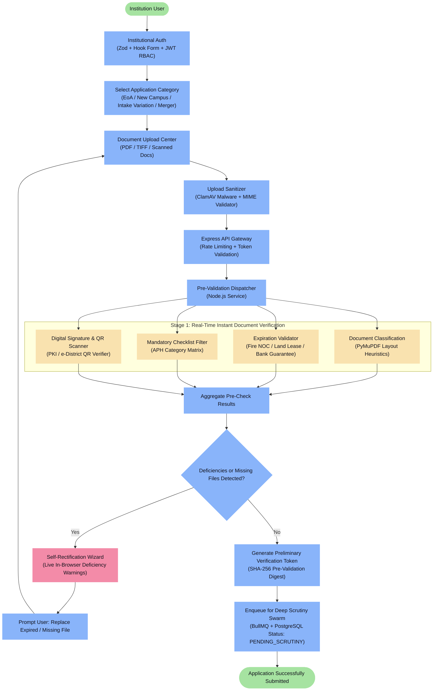
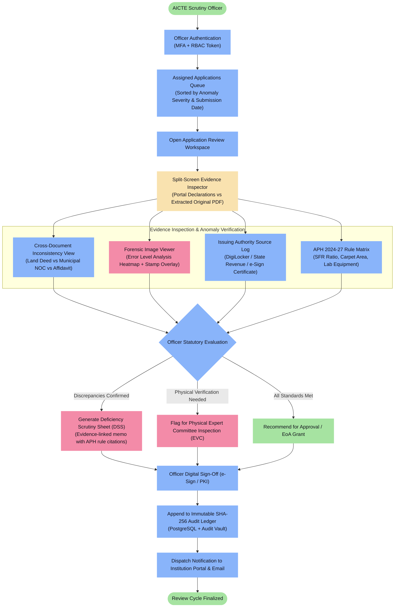
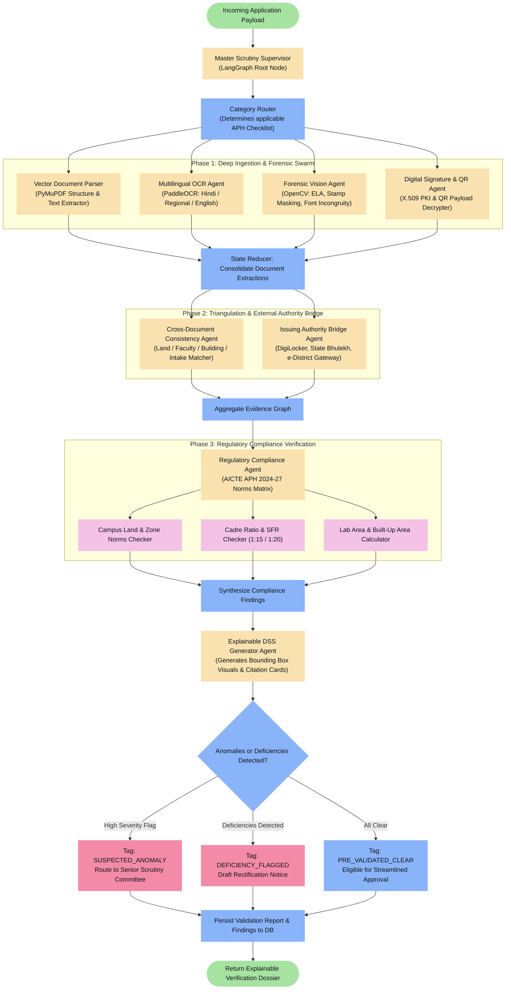
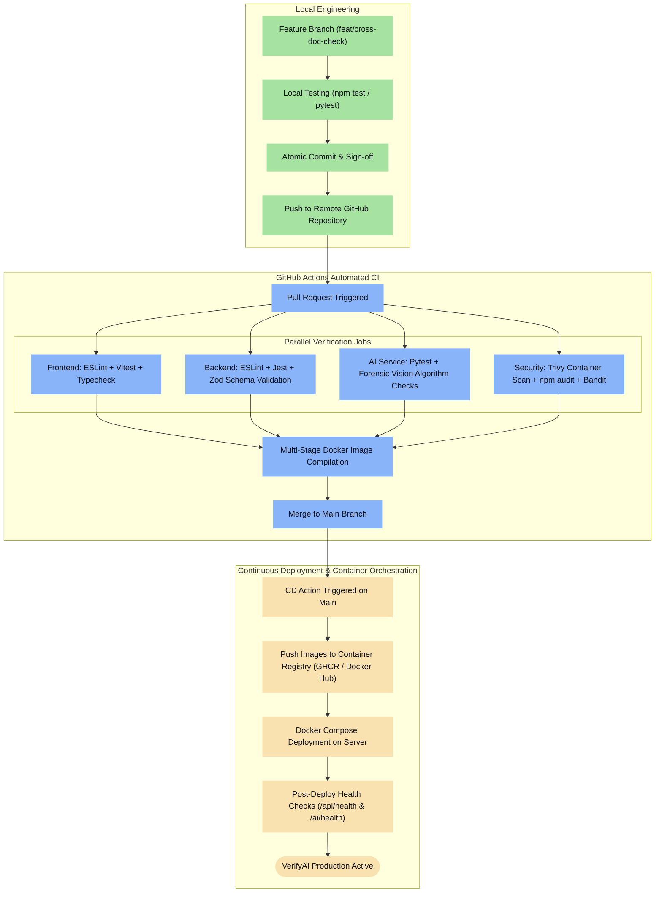
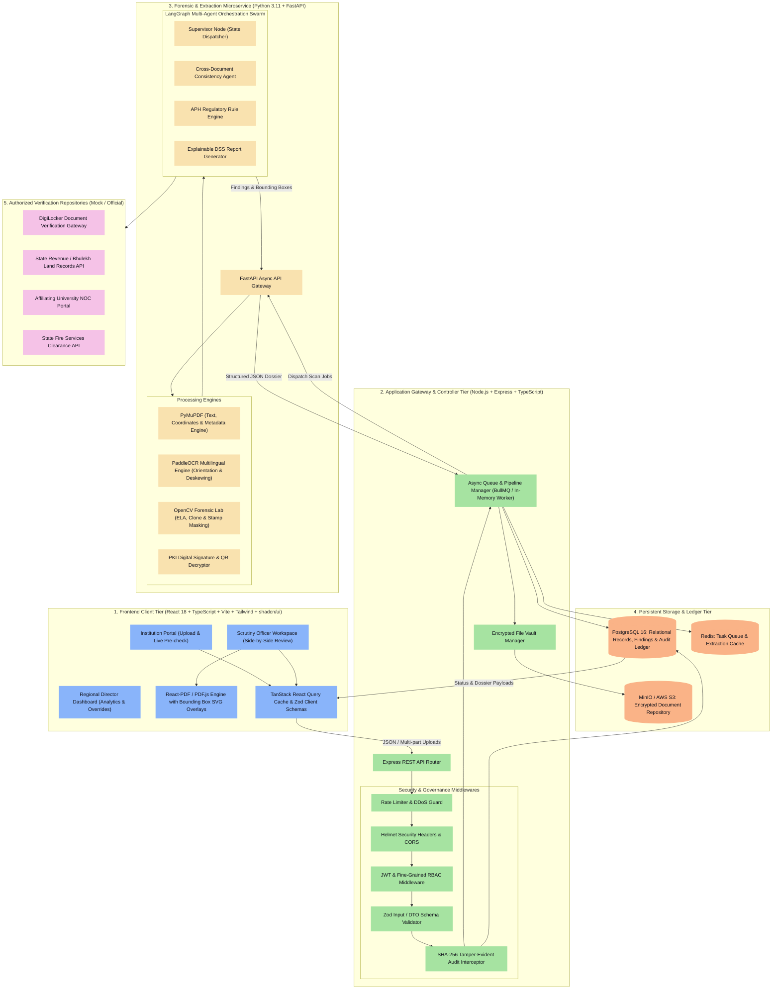
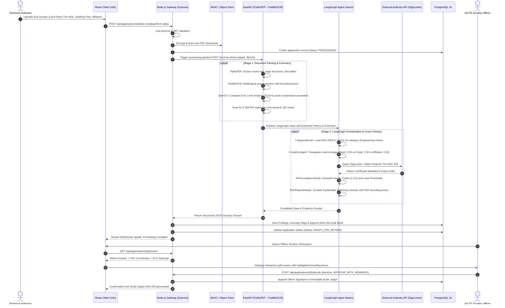
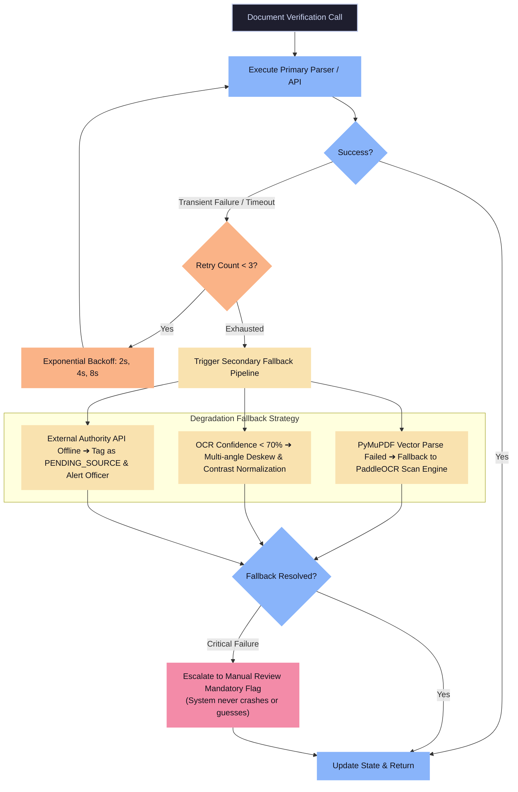

# VerifyAI — AI-Powered Application Validation, Document Authentication & Regulatory Compliance Platform


[](https://www.aicte-india.org/)
[](https://sih.gov.in/)
[](https://github.com/)
[](https://docker.com)
[](LICENSE)

---

## Executive Overview

Every academic cycle, the **All India Council for Technical Education (AICTE)** processes tens of thousands of institutional applications for **Extension of Approval (EoA)**, new technical campus approvals, intake variations, and institutional mergers under the mandates of the **AICTE Approval Process Handbook (APH)**.

Scrutinizing millions of physical and scanned pages—land ownership deeds, municipal building approvals, fire safety clearances, structural stability certificates, faculty rolls, and bank guarantees—is an arduous, repetitive, and time-critical operation. AICTE scrutiny committees face persistent operational bottlenecks:
- **Scattered Information & Cross-Document Inconsistencies**: Discrepancies between figures declared in the portal and figures buried across disparate affidavits, survey plans, and municipal certificates.
- **Sophisticated Document Tampering**: Pixel-level date alterations, copied rubber stamps, altered survey plot numbers, forged issuing authority seals, and recycled certificates shared across sister campuses.
- **Verification Latency**: Prolonged delays in manual verification against state revenue portals, universities, and issuing authority databases.
- **Subjective Human Scrutiny & Inconsistent Checklists**: Variability in deficiency interpretation and checklist application across different regional offices.

**VerifyAI** is an enterprise-grade, secure, transparent, and explainable **AI-Decision Support System (DSS)** designed for deep integration into the AICTE National Portal. It automates upstream document validation, performs multi-lingual optical extraction, runs forensic computer-vision manipulation detection, connects with authorized issuing-authority APIs (DigiLocker, State Land Portals, e-Courts, QR Verifiers), and evaluates extracted records against configurable APH regulatory rules—**while rigorously preserving 100% human-in-the-loop statutory scrutiny and sovereign decision-making**.

---

## Table of Contents

1. [Institutional Applicant Workflow](#1-institutional-applicant-workflow)
2. [AICTE Scrutiny Officer & Admin Workflow](#2-aicte-scrutiny-officer--admin-workflow)
3. [VerifyAI Agent Internal Flow (LangGraph Swarm)](#3-verifyai-agent-internal-flow-langgraph-swarm)
4. [Project Development & CI/CD Workflow](#4-project-development--cicd-workflow)
5. [Complete System Architecture](#5-complete-system-architecture)
   - [5a. Architecture Walkthrough & Execution Trace](#5a-architecture-walkthrough--execution-trace)
6. [Multi-Agent Swarm — Agent I/O Specifications](#6-multi-agent-swarm--agent-io-specifications)
7. [Forensic Vision & Manipulation Detection Engine](#7-forensic-vision--manipulation-detection-engine)
8. [Issuing Authority Verification Gateway](#8-issuing-authority-verification-gateway)
9. [Error Handling, Fallback & Retry Strategy](#9-error-handling-fallback--retry-strategy)
10. [Deployment & Infrastructure Topology](#10-deployment--infrastructure-topology)
11. [Security, DPDP Compliance & Statutory Safeguards](#11-security-dpdp-compliance--statutory-safeguards)
12. [Observability, Telemetry & Audit Chains](#12-observability-telemetry--audit-chains)
13. [Functional Execution Scenarios (Simulated Demos)](#13-functional-execution-scenarios-simulated-demos)
14. [Technology Stack](#14-technology-stack)
15. [Modular Project Structure](#15-modular-project-structure)
16. [Local Setup and Execution Guide](#16-local-setup-and-execution-guide)

---

## 1. Institutional Applicant Workflow

Traces the execution path starting from institutional client login, Zod schema validation, multi-document parallel upload, real-time pre-validation checks, AI-guided deficiency rectification, to final submission into the AICTE processing queue.



---

## 2. AICTE Scrutiny Officer & Admin Workflow

Details role-based access for AICTE Scrutiny Officers, Regional Directors, and Central Administrators to review evidence-linked findings, inspect anomalies, view digital verification sources, and issue statutory decisions.



---

## 3. VerifyAI Agent Internal Flow (LangGraph Swarm)

Highlights the multi-agent decision graph orchestrated via **LangGraph**, where specialized agents handle layout classification, multilingual OCR extraction, forensic image tampering detection, cross-document correlation, and APH compliance checks.



---

## 4. Project Development & CI/CD Workflow

Illustrates the Git feature-branch workflow, automated multi-runtime CI pipelines via GitHub Actions, containerized unit and integration testing, security scanning, and deployment stages.



---

## 5. Complete System Architecture

Maps the system across functional boundaries: Frontend Client Tier, Node.js Gateway & Orchestrator Tier, Python AI & Forensic Microservice Tier, LangGraph Agent Cluster, External Verification Repositories, and Persistent Storage Vaults.



---

### 5a. Architecture Walkthrough & Execution Trace

Here is the exact step-by-step sequence diagram when an institution submits a set of approval documents and the system executes extraction, anomaly checks, authority calls, and APH compliance:



---

## 6. Multi-Agent Swarm — Agent I/O Specifications

The LangGraph orchestration swarm distributes specialized verification tasks across discrete, state-bounded agents:

| Agent Name | Primary Responsibility | Input Parameters | Output Products |
| :--- | :--- | :--- | :--- |
| **CategoryRouter** | Identifies application type and loads the appropriate AICTE Handbook checklist. | `application_type`, `institute_category`, `program_list` | `active_aph_checklist`, `mandatory_document_keys` |
| **VectorParserAgent** | Extracts native digital text, bounding boxes, tables, and PDF font metrics. | `raw_pdf_bytes`, `page_indices` | `structured_text_blocks`, `bounding_boxes`, `pdf_metadata` |
| **MultilingualOCRAgent** | Executes optical character recognition on scanned deeds, affidavits, and seals. | `scanned_image_arrays`, `language_hints` (hi, en) | `ocr_tokens`, `word_coordinates`, `confidence_scores` |
| **ForensicVisionAgent** | Detects digital tampering via ELA, copy-move cloning, and seal edge incongruities. | `image_matrices`, `compression_quality=95` | `ela_tamper_score`, `suspicious_bounding_boxes`, `heatmap_png` |
| **CrossDocConsistencyAgent** | Correlates extracted values across separate documents to detect factual contradictions. | `extracted_entities_map`, `portal_declared_fields` | `discrepancy_flags`, `mismatch_deltas`, `evidence_pairs` |
| **IssuingAuthorityAgent** | Queries digital authorities (DigiLocker, State Land Portals, e-District QR). | `doc_ref_no`, `qr_payload`, `authority_type` | `auth_status` *(VERIFIED / MISMATCH / EXPIRED)*, `source_stamp` |
| **APHComplianceAgent** | Evaluates institutional parameters against mathematical AICTE APH regulatory norms. | `total_intake`, `land_area`, `faculty_list`, `built_up_area` | `compliance_pass_fail_map`, `shortfall_amounts`, `aph_clause_citations` |
| **DSSGeneratorAgent** | Synthesizes all findings into an explainable, evidence-backed Deficiency Scrutiny Sheet. | `all_agent_states`, `audit_trace` | `deficiency_memo_pdf`, `officer_action_summary`, `sha256_digest` |

---

## 7. Forensic Vision & Manipulation Detection Engine

VerifyAI incorporates a multi-spectrum forensic computer vision pipeline to protect the regulatory process from altered certificates:

```
                      [ Uploaded Document Image / PDF Page ]
                                        │
           ┌────────────────────────────┼────────────────────────────┐
           ▼                            ▼                            ▼
  [ Error Level Analysis ]     [ Font Incongruity Check ]   [ Seal & Stamp Verifier ]
  • Resaves at 95% quality     • Measures baseline variance • Isolates circular seals
  • Computes pixel diff scale  • Detects mismatched kerning • Checks color distribution
  • Generates high-loss mask   • Flags overlaid font glyphs • Masks duplicate stamp uses
           │                            │                            │
           └────────────────────────────┼────────────────────────────┘
                                        ▼
                   [ Forensic Fusion & Confidence Scorer ]
                     ├── Green: Natural document compression
                     ├── Orange: Minor artifacting (Scanned reprint)
                     └── Red: Pixel manipulation detected (Date / Number altered)
```

1. **Error Level Analysis (ELA)**:
   - Resaves digital images at a known compression baseline (95%) and evaluates the matrix difference:
     $$\Delta(x, y) = |I_{\text{original}}(x, y) - I_{\text{recompressed}}(x, y)| \times \text{Scale Factor}$$
   - Pixels altered with editing software (Photoshop, Canva, Acrobat Edit) display sharply elevated error levels compared to the original background substrate.
2. **Font & Metadata Forensics**:
   - Analyzes font resource tables embedded inside PDF objects. Flags documents containing multiple embedded subsets for single numerical fields (e.g., date modified from `2023` to `2027`).
   - Parses EXIF and XMP streams to flag modifying software signatures (`CreatorTool: Adobe Photoshop`, mismatched `ModifyDate` vs `CreateDate`).
3. **Cross-Institutional Perceptual Hashing (pHash)**:
   - Generates 64-bit DCT perceptual hashes for submitted building photographs and structural floorplans.
   - Detects if an identical building or computer center photograph has been recycled across multiple distinct institutional applications.

---

## 8. Issuing Authority Verification Gateway

VerifyAI provides automated connectors to authorized digital issuing repositories:

```
                            [ VerifyAI Gateway ]
                                     │
           ┌─────────────────────────┼─────────────────────────┐
           ▼                         ▼                         ▼
   [ DigiLocker API ]        [ State Land Registry ]    [ PKI & Dynamic QR ]
   • Fetches verified        • Queries Land Records     • Decrypts 2D Secure QR
     Building Safety / NOC     (e.g., Bhulekh, AP       • Validates X.509 digital
   • Compares cryptographic    Meebhoomi, TamilNilam)     signatures against CCA
     URI and timestamp       • Confirms survey / khata    India root certs
```

### Verification Status Enumeration
Every document processed receives an unambiguous, auditable status tag:
- `VERIFIED`: Exact match between document data and issuing authority database.
- `MISMATCH_DETECTED`: Authority record located, but critical parameters (name, survey number, validity) differ.
- `EXPIRED`: Document authentic, but current date exceeds statutory validity window.
- `PENDING_SOURCE`: External issuing portal currently unreachable (automatic retry enqueued).
- `SOURCE_UNAVAILABLE`: Document type has no public API; automatically flagged for **Manual Verification Mandatory**.

---

## 9. Error Handling, Fallback & Retry Strategy

VerifyAI implements resilient fault-tolerance patterns across every operational boundary:



---

## 10. Deployment & Infrastructure Topology

The production architecture is containerized via Docker and deployable across on-premise NIC/AICTE data centers or sovereign cloud providers:

```
                            [ External Traffic: HTTPS:443 ]
                                          │
                                          ▼
                         [ NGINX Reverse Proxy & SSL Term ]
                                          │
            ┌─────────────────────────────┴─────────────────────────────┐
            ▼                                                           ▼
 [ Frontend React Static App ]                               [ Backend API Gateway ]
   (Vite Build / NGINX Server)                                (Node.js 20 Express)
   Port: 80 / 5173                                            Port: 5000
                                                                        │
                                       ┌────────────────────────────────┴────────────────┐
                                       ▼                                                 ▼
                          [ AI Microservice Engine ]                            [ Postgres 16 DB ]
                           (Python 3.11 + FastAPI)                              Relational & Audit
                           Port: 8000                                           Port: 5432
                                       │
                                       ├────────────────────────────────┐
                                       ▼                                ▼
                          [ MinIO S3 Object Store ]              [ Redis 7 Cache ]
                           Document Encrypted Vault               Task Queue / PubSub
                           Port: 9000 / 9001                      Port: 6379
```

---

## 11. Security, DPDP Compliance & Statutory Safeguards

### Non-Autonomous Decision-Support Mandate
Under Section 10 of the AICTE Act and the official problem requirements, **VerifyAI does not autonomously reject or approve any application**.
- All AI-generated outputs serve strictly as **advisory decision-support intelligence**.
- Rejections, deficiency notices, and inspection orders require explicit review, written justification, and cryptographic e-Sign sign-off from authorized AICTE officers.

### Data Protection & Cryptographic Audit Trails
- **DPDP Act (2023) Compliance**: PII fields (such as faculty Aadhaar numbers, personal phone numbers, and bank account balances) are masked with SHA-256 salts prior to LLM/agent processing.
- **SHA-256 Tamper-Evident Ledger**: Every state transition generates a cryptographic digest linked to the preceding record:
  $$\text{Block Hash} = \text{SHA-256}\Big(\text{PrevHash} + \text{Timestamp} + \text{AppID} + \text{OfficerID} + \text{Action} + \text{FindingsHash}\Big)$$
  Ensures absolute legal admissibility during statutory appeals, RTI filings, and High Court inquiries.

---

## 12. Observability, Telemetry & Audit Chains

VerifyAI provides comprehensive system telemetry and compliance tracking:
- **Application Processing Timeline**: Real-time Gantt timeline tracking milliseconds spent in OCR, forensics, cross-checking, and authority queries.
- **Confidence Distribution Histograms**: Real-time monitoring of OCR confidence scores across different regional languages and document layouts.
- **Audit Event Inspector**: Searchable, role-filtered log viewer displaying who reviewed which application, what evidence was inspected, and all historical decisions.

---

## 13. Functional Execution Scenarios (Simulated Demos)

### Scenario A: Clean Application (`Case 01 — Urban Engineering EoA`)
- **Institution**: APEX Institute of Technology (New Delhi).
- **Submitted Docs**: Land Deed (2.75 Acres), Fire NOC (Valid to 2026), Municipal Plan, Faculty List (SFR 1:15).
- **VerifyAI Outcome**: 
  - ✅ Land norm satisfied (Min required: 2.50 Acres).
  - ✅ Fire NOC verified via Delhi Fire Service API.
  - ✅ Faculty cadre ratio 1:2:6 perfectly compliant.
  - **Status**: `PRE_VALIDATED_CLEAR` (Eligible for accelerated scrutiny).

### Scenario B: Tampered Fire Safety NOC (`Case 02 — Forgery Flag`)
- **Institution**: Vidya Technical College.
- **Submitted Docs**: Fire NOC purportedly valid until November 2027.
- **VerifyAI Outcome**:
  - 🚨 **ELA Forensics**: High error-level compression box detected precisely around the digit `7` in `2027`.
  - 🚨 **PDF Metadata**: Modified via `Adobe Photoshop 2022` on 14-Oct-2026.
  - 🚨 **Issuing Authority API**: State Fire records show original certificate expired on 14-Nov-2023.
  - **Status**: `SUSPECTED_ANOMALY` (Routed directly to Senior Committee with evidence overlay).

### Scenario C: Cross-Document Acreage Inconsistency (`Case 03 — Contradiction`)
- **Institution**: Green Valley Polytechnic.
- **Submitted Docs**: Portal declares 4.0 Acres. Land Sale Deed Schedule 'A' text extract calculates to 2.8 Acres.
- **VerifyAI Outcome**:
  - ⚠️ **Cross-Document Mismatch**: Portal acreage (4.0) deviates from Deed extracted acreage (2.80) by 1.20 Acres.
  - ⚠️ **Handbook Rule Check**: Rural polytechnic requires 3.0 Acres minimum. True acreage creates 0.20 Acre deficit.
  - **Status**: `DEFICIENCY_FLAGGED` (Auto-drafts Deficiency Scrutiny Memo citing APH Clause 4.1.2).

---

## 14. Technology Stack

VerifyAI is built strictly adhering to the modern, performant, and reliable technology stack specified for enterprise AICTE deployment:

```
├── 1. Frontend Web Client
│   ├── React 18 & TypeScript (Type-safe, component-driven UI architecture)
│   ├── Vite (Next-generation high-speed build tool and dev server)
│   ├── Tailwind CSS (Configured with government-grade design color palettes)
│   ├── shadcn/ui & Radix UI (Accessible, unstyled primitives for tables, modals, tabs)
│   ├── Lucide React (Clean, modern iconography)
│   └── React-PDF / PDF.js (High-fidelity vector canvas PDF rendering with SVG bounding overlays)
│
├── 2. Main Backend Gateway
│   ├── Node.js 20 LTS & Express
│   ├── TypeScript (Shared types across gateway and client DTOs)
│   ├── Zod (Rigorous runtime schema validation for requests and payloads)
│   ├── JWT & Multi-Role RBAC (Institution, Scrutiny Officer, Regional Director, Admin)
│   ├── Multer & ClamAV (Secure multi-part upload handling with virus isolation)
│   └── BullMQ / Redis (Asynchronous background worker orchestration)
│
├── 3. AI & Forensic Microservice
│   ├── Python 3.11 & FastAPI (High-concurrency async processing endpoints)
│   ├── PyMuPDF (fitz) (Direct vector PDF text, page geometry, font-table parser)
│   ├── PaddleOCR (Multilingual Indian script OCR: Hindi, Regional & English)
│   ├── OpenCV & NumPy (Error Level Analysis, clone detection, stamp edge extraction)
│   └── Pillow (Image recompression and matrix manipulation)
│
├── 4. AI Workflow Orchestration
│   ├── LangGraph (Stateful multi-actor agent decision graph and cyclic flows)
│   ├── LLM Provider Adapter (Flexible support for local Ollama/Mistral or sovereign cloud LLMs)
│   └── Prompt Guardrails (Strict zero-hallucination regulatory citation filters)
│
├── 5. Database & Storage Vault
│   ├── PostgreSQL 16 (Relational schemas, application states & immutable audit trail)
│   ├── SQLAlchemy 2.0 & Alembic (Python ORM & automated database migrations)
│   └── MinIO / AWS S3 (Private, encrypted S3-compatible document storage)
│
└── 6. DevOps & Quality Assurance
    ├── Docker & Docker Compose (One-command orchestration across all services)
    ├── GitHub Actions (Continuous Integration linting, security scans, unit tests)
    ├── Pytest (FastAPI route tests, OCR evaluation & forensic algorithm benchmarks)
    └── Vitest & React Testing Library (Frontend UI component and store testing)
```

---

## 15. Modular Project Structure

```
aicte-verifyai/
├── .github/
│   └── workflows/
│       ├── ci-backend.yml              # Node.js build, lint & unit tests
│       ├── ci-ai-service.yml           # Pytest suite & forensic benchmarks
│       └── ci-frontend.yml             # Vite build & Vitest test suites
├── docker-compose.yml                  # Complete multi-service orchestration
├── .env.example                        # Unified environment configuration
│
├── apps/
│   ├── frontend/                       # React 18 + TypeScript + Vite Client
│   │   ├── src/
│   │   │   ├── assets/                 # Emblems, AICTE branding & icons
│   │   │   ├── components/
│   │   │   │   ├── audit/              # Cryptographic timeline & log viewer
│   │   │   │   ├── dashboard/          # Summary metrics, status charts
│   │   │   │   ├── inspection/         # Split-screen PDF viewer with bounding boxes
│   │   │   │   ├── ui/                 # shadcn/ui primitives
│   │   │   │   └── upload/             # Multi-file upload with instant pre-validation
│   │   │   ├── hooks/                  # Custom React hooks (useApplication, useDossier)
│   │   │   ├── layouts/                # Portal and Officer dashboard layouts
│   │   │   ├── pages/                  # Route pages (Login, ReviewWorkspace, Analytics)
│   │   │   └── services/               # Axios/Fetch client with interceptors
│   │   ├── package.json
│   │   ├── tailwind.config.js
│   │   └── vite.config.ts
│   │
│   ├── backend/                        # Node.js + Express + TypeScript Gateway
│   │   ├── src/
│   │   │   ├── config/                 # Environment, Postgres & S3 connectors
│   │   │   ├── controllers/            # Route controllers (auth, apps, review, audit)
│   │   │   ├── middlewares/            # RBAC, Zod validator, audit interceptor
│   │   │   ├── models/                 # Database interfaces and DTOs
│   │   │   ├── routes/                 # REST endpoints (/api/v1/applications, etc.)
│   │   │   └── utils/                  # SHA-256 cryptographic chain helpers
│   │   ├── package.json
│   │   └── tsconfig.json
│   │
│   └── ai-service/                     # Python 3.11 + FastAPI Microservice
│       ├── app/
│       │   ├── api/                    # FastAPI routes (/v1/scrutinize, /v1/forensics)
│       │   ├── core/                   # App configs and security models
│       │   ├── forensica/              # ELA, metadata, clone detection algorithms
│       │   ├── ocr/                    # PyMuPDF parser & PaddleOCR pipelines
│       │   ├── rules/                  # Configurable APH 2024-27 rule matrices
│       │   ├── workflows/              # LangGraph multi-agent decision state graph
│       │   └── main.py                 # FastAPI application root
│       ├── tests/                      # Pytest suite with sample synthetic documents
│       ├── requirements.txt
│       └── Dockerfile
│
├── data/
│   ├── rules/
│   │   └── aicte_aph_2024_27.json      # Machine-readable AICTE handbook thresholds
│   └── sample_datasets/                # Curated evaluation dossiers
│       ├── 01_valid_engineering_eoa/
│       ├── 02_forged_fire_noc/
│       └── 03_mismatched_land_deed/
│
└── docs/
    ├── ARCHITECTURE.md                 # System specifications & sequence traces
    ├── COMPLIANCE_MATRIX.md            # Mapping to AICTE Approval Process Handbook
    └── API_REFERENCE.md                # OpenAPI / Swagger specification
```

---

## 16. Local Setup and Execution Guide

### Prerequisites
- **Docker & Docker Compose** (v24+ recommended)
- Or for bare-metal setup: **Node.js 20 LTS**, **Python 3.11**, **PostgreSQL 16**, and **MinIO / Redis**

---

### Method A: One-Command Docker Compose (Fastest & Recommended)

1. **Clone the repository**:
   ```bash
   git clone https://github.com/your-org/aicte-verifyai.git
   cd aicte-verifyai
   ```

2. **Initialize Environment Variables**:
   ```bash
   cp .env.example .env
   ```

3. **Build and launch the complete multi-service stack**:
   ```bash
   docker compose up --build -d
   ```

4. **Verify Running Services**:
   ```bash
   docker compose ps
   ```

5. **Access Application Interfaces**:
   - 🖥️ **VerifyAI Web Portal**: [http://localhost:5173](http://localhost:5173)
   - 🌐 **Node.js Gateway Health**: [http://localhost:5000/api/health](http://localhost:5000/api/health)
   - 🧠 **FastAPI AI Docs & Swagger**: [http://localhost:8000/docs](http://localhost:8000/docs)
   - 🗄️ **MinIO Object Console**: [http://localhost:9001](http://localhost:9001) *(User: `minioadmin` / Pass: `minioadmin`)*

---

### Method B: Manual Bare-Metal Developer Setup

#### Step 1: Start PostgreSQL and Redis
Ensure PostgreSQL is running locally on port `5432` with a database named `verifyai`, and Redis on port `6379`.

#### Step 2: Launch the AI & Document Processing Microservice (Python)
```bash
cd apps/ai-service

# Create and activate virtual environment
python -m venv venv
# On Windows:
.\venv\Scripts\activate
# On Linux / macOS:
source venv/bin/activate

# Install dependencies
pip install --upgrade pip
pip install -r requirements.txt

# Start FastAPI development server
uvicorn app.main:app --host 0.0.0.0 --port 8000 --reload
```

#### Step 3: Launch the Main Backend Gateway (Node.js)
```bash
cd apps/backend

# Install dependencies
npm install

# Run database migrations
npm run db:migrate

# Start Node.js API development server
npm run dev
```

#### Step 4: Launch the Frontend Web Application (React + Vite)
```bash
cd apps/frontend

# Install dependencies
npm install

# Start Vite hot-reloading development server
npm run dev
```

---

### Running Automated Test Suites

```bash
# 1. Run Python AI, OCR & Forensic tests:
cd apps/ai-service
pytest tests/ -v

# 2. Run Backend Gateway unit and integration tests:
cd apps/backend
npm test

# 3. Run Frontend unit and component tests:
cd apps/frontend
npm run test
```

---

## 👥 The Team & Hackathon Contribution

Developed with ❤️ for the **Smart India Hackathon (SIH)** under the auspices of the **AICTE Innovation Cell**, Ministry of Education, Government of India.

*Engineered to uphold the sanctity of technical education in India through trustworthy, explainable, and responsible artificial intelligence.*

---

## 📄 License & Attribution

This project is licensed under the **MIT License** - see the [LICENSE](LICENSE) file for details.  
All regulatory checklists and Approval Process Handbook (APH) citations are intellectual property of the **All India Council for Technical Education (AICTE)**.
