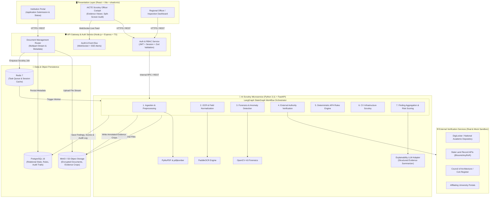
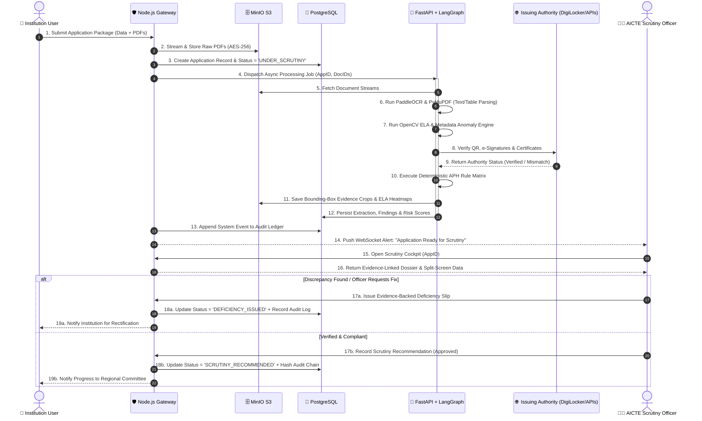
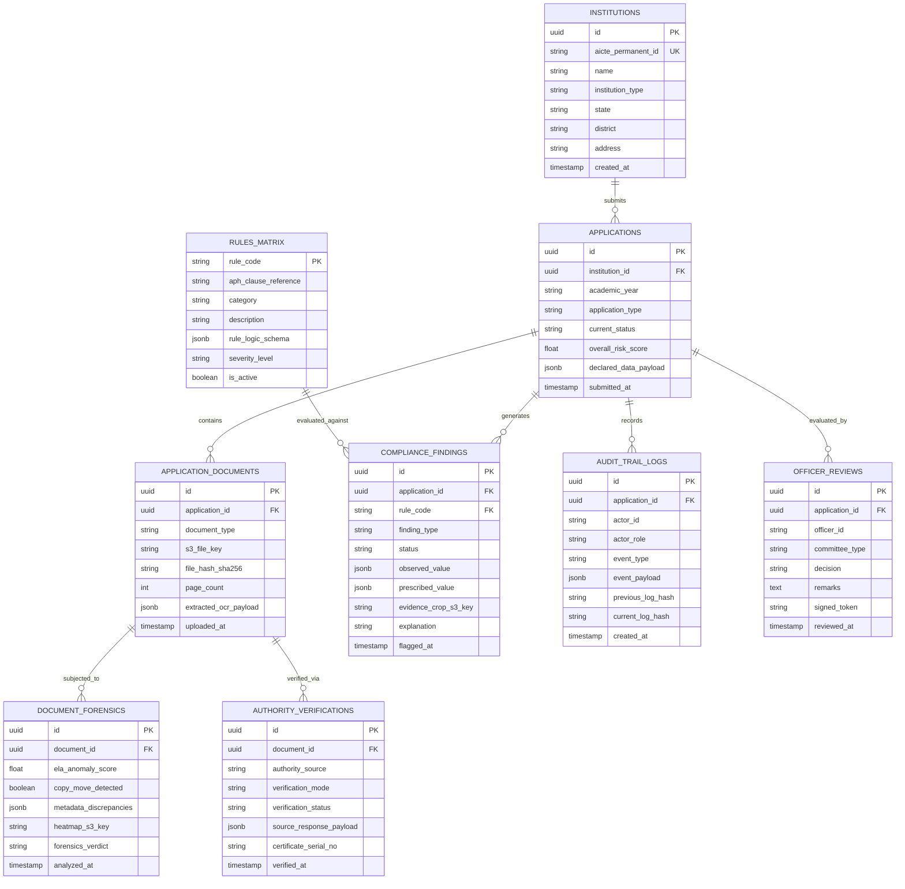

# 🏛️ AICTE Pragyan-Drishti (प्रज्ञान दृष्टि)
### AI-Powered Institutional Application Validation, Document Authentication & Regulatory Compliance Verification Platform

[](https://sih.gov.in)
[](https://www.aicte-india.org)
[](https://react.dev)
[](https://nodejs.org)
[](https://fastapi.tiangolo.com)
[](https://langchain-ai.github.io/langgraph/)
[](https://www.postgresql.org)
[](https://www.docker.com)

---

## 📑 Table of Contents

- [1. Executive Summary & Problem Context](#1-executive-summary--problem-context)
  - [1.1 Background: The AICTE Approval Process](#11-background-the-aicte-approval-process)
  - [1.2 The Core Problem](#12-the-core-problem)
  - [1.3 Strategic Solution: Pragyan-Drishti](#13-strategic-solution-pragyan-drishti)
- [2. System Objectives & Design Principles](#2-system-objectives--design-principles)
- [3. End-to-End System Architecture](#3-end-to-end-system-architecture)
  - [3.1 High-Level Architecture Diagram](#31-high-level-architecture-diagram)
  - [3.2 Microservice Breakdown](#32-microservice-breakdown)
- [4. AI & Workflow Orchestration (LangGraph Engine)](#4-ai--workflow-orchestration-langgraph-engine)
  - [4.1 LangGraph StateGraph Workflow Diagram](#41-langgraph-stategraph-workflow-diagram)
  - [4.2 Workflow Steps & Conditional Fallbacks](#42-workflow-steps--conditional-fallbacks)
- [5. Core Modules & Technical Implementation](#5-core-modules--technical-implementation)
  - [5.1 Module A: Document Extraction & Classification (PaddleOCR + PyMuPDF)](#51-module-a-document-extraction--classification-paddleocr--pymupdf)
  - [5.2 Module B: Forensics & Anomaly Detection (OpenCV + Metadata Analysis)](#52-module-b-forensics--anomaly-detection-opencv--metadata-analysis)
  - [5.3 Module C: Authority Verification (DigiLocker, QR, e-Sign, Land Registries)](#53-module-c-authority-verification-digilocker-qr-e-sign-land-registries)
  - [5.4 Module D: Deterministic APH Regulatory Compliance Engine](#54-module-d-deterministic-aph-regulatory-compliance-engine)
  - [5.5 Module E: Infrastructure CV Analysis & Geotag Verification](#55-module-e-infrastructure-cv-analysis--geotag-verification)
  - [5.6 Module F: Scrutiny Officer Dashboard & Human-in-the-Loop Review](#56-module-f-scrutiny-officer-dashboard--human-in-the-loop-review)
  - [5.7 Module G: Immutable Audit Trail & Evidence Chains](#57-module-g-immutable-audit-trail--evidence-chains)
- [6. Sequence Flow Diagram](#6-sequence-flow-diagram)
- [7. Database Schema & Data Modeling (ERD)](#7-database-schema--data-modeling-erd)
  - [7.1 Entity-Relationship Diagram](#71-entity-relationship-diagram)
  - [7.2 Key Entity Specifications](#72-key-entity-specifications)
- [8. Technology Stack Specification](#8-technology-stack-specification)
- [9. Repository Directory Structure](#9-repository-directory-structure)
- [10. API Specification & Integration Contracts](#10-api-specification--integration-contracts)
- [11. Installation & Local Development Setup](#11-installation--local-development-setup)
  - [11.1 Prerequisites](#111-prerequisites)
  - [11.2 Quickstart with Docker Compose](#112-quickstart-with-docker-compose)
  - [11.3 Manual Local Setup (Frontend, Backend, AI Engine)](#113-manual-local-setup-frontend-backend-ai-engine)
- [12. Evaluation Metrics & Benchmark Dataset](#12-evaluation-metrics--benchmark-dataset)
- [13. Security, Privacy & Legal Safeguards](#13-security-privacy--legal-safeguards)
- [14. Placement & Software Engineering Highlights](#14-placement--software-engineering-highlights)
- [15. License & Team Acknowledgments](#15-license--team-acknowledgments)

---

## 1. Executive Summary & Problem Context

### 1.1 Background: The AICTE Approval Process
The **All India Council for Technical Education (AICTE)**, established under the Ministry of Education, Government of India, is the statutory body regulating technical and management education institutions nationwide. Every academic year, thousands of institutions submit applications for:
- **Extension of Approval (EoA)** for existing institutions.
- **Establishment of New Technical Institutions**.
- **Increase in Intake / Addition of New Courses / Emerging Areas**.
- **Closure of Courses / Change of Site / Conversion of Diploma to Degree**.

Processing these applications requires rigorous multi-tiered verification against the **AICTE Approval Process Handbook (APH)**, institutional historic records, municipal land records, fire safety certifications, building approvals, and university affiliations.

### 1.2 The Core Problem
1. **Intense Document Volume & Variety:** A single application involves 30–70 multi-page documents (deeds, NOCs, land certificates, architect floor plans, bank guarantees, audited balance sheets, faculty appointment letters, FSR declarations).
2. **Manual Scrutiny Bottlenecks:** Manual verification of stamps, signatures, dates, and cross-consistency with past AICTE records takes weeks per institute, delaying the academic calendar.
3. **Document Tampering & Fraud Vectors:** Forged municipal NOCs, doctored dates on expired fire certificates, digitally manipulated architect certificates, copy-pasted floor plans, and fabricated faculty credentials.
4. **Disjointed Verification Channels:** Lack of an integrated bridge to query issuing authorities (DigiLocker, State Land Records, PWD/Municipal portals, Council of Architecture).
5. **Human Fatigue & Subjectivity:** Variability in manual scrutiny reports, missing deficiency notices, and non-transparent dispute resolutions.

### 1.3 Strategic Solution: Pragyan-Drishti
**Pragyan-Drishti** is a secure, cloud-native, AI-assisted decision-support platform designed for seamless integration with the AICTE Web Portal. It automates:
- Multi-format ingestion and high-fidelity text extraction via **PaddleOCR** and **PyMuPDF**.
- Computer-vision-driven **tamper and forgery detection** (ELA, metadata mismatch, copy-move detection).
- Direct **issuing authority verification** (DigiLocker, QR decoding, PKI e-Sign verification).
- Strict, **deterministic rule-based compliance evaluation** against AICTE APH norms (never delegating regulatory approvals to stochastic LLMs).
- A stateful **LangGraph orchestration** workflow connecting OCR, checks, and advisory findings.
- An intuitive **Officer Scrutiny Cockpit** delivering evidence-linked findings with an immutable audit trail, strictly upholding **Human-in-the-Loop (HITL)** governance.

---

## 2. System Objectives & Design Principles

| Objective | Engineering Mechanism | Outcome |
| :--- | :--- | :--- |
| **Instant Ingestion & Classification** | PaddleOCR + PyMuPDF layout analysis + LangGraph classification | Instant categorization of 20+ statutory document types; automated missing-document alert. |
| **Tamper & Anomaly Detection** | OpenCV Error Level Analysis (ELA), font variance checks, EXIF metadata cross-auditing | Flags manipulated text boxes, modified dates, digital splices, and cloned stamps with confidence scores. |
| **Authoritative Verification** | QR code parsing, PKI X.509 signature validation, DigiLocker sandbox integration | Validates document authenticity against issuing authorities; flags expired/mismatched certificates. |
| **Deterministic Regulatory Scrutiny** | Python AST rule engine encoded with AICTE APH formulas (Land, FSR, Cadre, Carpet Area) | Eliminates AI hallucination; generates mathematically sound, reproducible pass/deficiency reports. |
| **Infrastructure Evidence Audit** | Computer Vision (CV) floor plan dimension extractor + geotag metadata validation | Flags discrepancies in lab carpet areas, classroom counts, barrier-free access, and fire exits. |
| **Explainable HITL Governance** | Bounding-box visual evidence overlay, JSON audit log, role-based committee approvals | AI never issues binding rejection/approval; all outputs serve as evidence-backed advisory reports for officers. |

---

## 3. End-to-End System Architecture

### 3.1 High-Level Architecture Diagram



### 3.2 Microservice Breakdown

1. **Frontend Client (`/frontend`):**
   - Built with **React 18**, **TypeScript**, **Tailwind CSS**, and **shadcn/ui**.
   - Features: Split-screen document inspection viewer (PDF.js + canvas annotation), side-by-side institutional claim vs. extracted truth, deficiency slip generator, real-time status tracker via WebSockets.
2. **Main Gateway Backend (`/backend-gateway`):**
   - Built with **Node.js**, **Express**, and **TypeScript**.
   - Handles multi-role authentication (Institution User, Scrutiny Officer, Regional Director, Super Admin), role-based access control (RBAC), file upload pipeline, Zod payload validation, and event streaming.
3. **AI & Forensics Engine (`/ai-engine`):**
   - Built with **Python 3.11** and **FastAPI**.
   - Encapsulates **LangGraph**, **PaddleOCR**, **PyMuPDF**, and **OpenCV**.
   - Operates asynchronously via Redis queues for long-running document scrutiny workloads.
4. **Persistence Layer:**
   - **PostgreSQL 16:** Relational modeling of applications, document metadata, rule trees, calculated compliance ratios, and tamper-evident audit logs.
   - **MinIO S3:** Stores raw institutional PDF/JPEG uploads, encrypted at rest (AES-256), along with forensic heatmaps and evidence bounding-box crops.

---

## 4. AI & Workflow Orchestration (LangGraph Engine)

The verification lifecycle is structured as a deterministic, state-driven workflow using **LangGraph**. Unlike uncontrolled autonomous LLM agents that hallucinate facts or decisions, LangGraph enforces strict node-by-node execution with explicit state typing, validation checkpoints, and fallback mechanisms.

### 4.1 LangGraph StateGraph Workflow Diagram

```mermaid
stateDiagram-v2
    [*] --> IngestDocumentPackage: Application Received
    
    IngestDocumentPackage --> DocumentClassification: Parse PDF Streams
    
    state DocumentClassification {
        [*] --> ClassifyDocType
        ClassifyDocType --> CheckChecklistCompleteness: Map to APH Category
        CheckChecklistCompleteness --> MissingDocsAlert: Missing Required Docs
        CheckChecklistCompleteness --> Preprocessing: All Required Present
    }

    MissingDocsAlert --> FlagDeficiency: Record Item in Deficiency Slip
    
    Preprocessing --> OCRAndExtraction: PyMuPDF + PaddleOCR
    
    state OCRAndExtraction {
        [*] --> ExtractTextAndTables
        ExtractTextAndTables --> ExtractEntities: Land Area, Reg Nos, Dates, Faculty Names
        ExtractEntities --> NormalizeEntities: Standardize Units & Formats
    }

    NormalizeEntities --> ParallelChecks: Dispatch Extracted State
    
    state ParallelChecks {
        direction LR
        state ForensicsAnalysis {
            [*] --> ErrorLevelAnalysis
            ErrorLevelAnalysis --> MetadataAudit
            MetadataAudit --> FontConsistencyCheck
        }
        state AuthorityVerification {
            [*] --> QRSignatureDecoder
            QRSignatureDecoder --> DigiLockerAPICheck
            DigiLockerAPICheck --> LandRegistryCheck
        }
        state DeterministicAPHCompliance {
            [*] --> CheckLandAndBuildingNorms
            CheckLandAndBuildingNorms --> CheckFSRAndFacultyCadre
            CheckFSRAndFacultyCadre --> CheckTERFeeAndAffiliation
        }
        state InfrastructureCV {
            [*] --> GeotagExifAudit
            GeotagExifAudit --> FloorPlanDimensionOCR
        }
    }

    ParallelChecks --> SynthesizeFindings: Merge Evidence & Flags

    state SynthesizeFindings {
        [*] --> CheckHighSeverityAnomalies
        CheckHighSeverityAnomalies --> HighRiskFlag: Forgery / Gross Deficiency Found
        CheckHighSeverityAnomalies --> AdvisorySummary: Valid / Minor Deficiencies
        HighRiskFlag --> CompileEvidence
        AdvisorySummary --> CompileEvidence
    }

    CompileEvidence --> HumanInTheLoopReview: Render in Scrutiny Cockpit
    
    state HumanInTheLoopReview {
        [*] --> OfficerInspection
        OfficerInspection --> ApproveWithNotes: Officer Validates & Concurs
        OfficerInspection --> IssueDeficiencyNotice: Officer Requests Rectification
        OfficerInspection --> TriggerPhysicalInspection: Infrastructure Discrepancy
    }

    ApproveWithNotes --> GenerateScrutinyReport: Emit Signed Report & Hash to Audit Log
    IssueDeficiencyNotice --> GenerateScrutinyReport
    TriggerPhysicalInspection --> GenerateScrutinyReport
    
    GenerateScrutinyReport --> [*]
```



### 4.2 Workflow Steps & Conditional Fallbacks

```python
# Conceptual LangGraph State Schema
class ApplicationScrutinyState(TypedDict):
    application_id: str
    institution_id: str
    category: str  # e.g., "Extension_of_Approval", "New_Institution"
    documents: List[DocumentMetadata]
    extracted_entities: Dict[str, Any]
    forensic_anomalies: List[AnomalyFinding]
    authority_verification_results: List[AuthVerificationResult]
    aph_compliance_results: Dict[str, ComplianceCheck]
    cv_infrastructure_findings: List[CVFinding]
    overall_risk_score: float
    evidence_crop_urls: List[str]
    audit_trail: List[AuditLogEntry]
    officer_action: Optional[str]
```

1. **`IngestDocumentPackage`**: Validates file hashes (SHA-256) to ensure no corrupt or duplicate files exist.
2. **`DocumentClassification`**: Matches document titles, headers, and stamps to the expected APH checklist for the chosen category (e.g., Engineering UG, Management PG, Pharmacy).
3. **`OCRAndExtraction`**: Dual-engine extraction using PyMuPDF for native vector PDFs and PaddleOCR for scanned raster images.
4. **`ForensicsAnalysis`**: Runs Error Level Analysis (ELA) to detect JPEG resaving artifacts, pixel splices, and cloned stamps.
5. **`AuthorityVerification`**: Reads QR codes and embedded digital signatures (X.509 PKI). If external API is unreachable, transitions gracefully to `SOURCE_UNAVAILABLE` and triggers a fallback manual verification flag without halting the pipeline.
6. **`DeterministicAPHCompliance`**: Mathematically evaluates requirements (Land Area in Acres, Carpet Area per student, Faculty-Student Ratio 1:15 or 1:20, Cadre Ratio 1:2:6).
7. **`HumanInTheLoopReview`**: Suspends workflow execution and presents the comprehensive dossier to the AICTE Scrutiny Officer. The system resumes execution only when the authorized officer submits a formal disposition.

---

## 5. Core Modules & Technical Implementation

### 5.1 Module A: Document Extraction & Classification (PaddleOCR + PyMuPDF)
- **Hybrid Extraction Pipeline:** Detects whether an uploaded PDF has native embedded text streams or is a flat scanned image.
- **Table Structure Extraction:** Uses `pdfplumber` and PaddleOCR Table Recognition to parse multi-column tables such as Faculty Lists (Name, PAN, Aadhaar hash, Designation, Date of Joining, Pay Scale) and Land Particulars (Khasra/Survey Numbers, Plot area, FSI).
- **Entity Normalization:** Standardizes dates (`DD/MM/YYYY`), currency amounts (TER processing fee payments), and unit conversions (acres, square meters, square feet) to canonical SI units for automated comparison.

### 5.2 Module B: Forensics & Anomaly Detection (OpenCV + Metadata Analysis)
- **Error Level Analysis (ELA):** Analyzes compression ratios across the document canvas. Re-saved or digitally pasted signatures, altered dates, and spliced text blocks stand out with high ELA variance.
- **Copy-Move Forgery Detection:** Identifies duplicated seals, stamps, or official signatures copied from older approvals or other institutes.
- **PDF Metadata Consistency Scrutiny:** Cross-references the PDF creation date, modification date, author software (e.g., Adobe Photoshop, Canva vs. Government Printing Office/Scanner drivers), and fonts used (detecting localized font variations in numeric fields).

### 5.3 Module C: Authority Verification (DigiLocker, QR, e-Sign, Land Registries)
- **Digital Signature (PAdES / PKI) Verification:** Extracts X.509 certificates from digitally signed documents (e.g., municipal approvals, chartered accountant certificates), verifying certificate chain, expiry, and revocation status via CRL/OCSP.
- **QR Code Verification:** Automatically scans and decodes high-density QR codes on University Affiliation letters, State Board certificates, and e-Stamps; cross-verifies decoded payload against the application's declared text.
- **DigiLocker / National Academic Depository (NAD) Bridge:** Connects to standard DigiLocker APIs (or sandbox simulation for demo) to verify ownership and document hashes directly from issuing authorities.
- **Graceful Degradation Statuses:** Every verification yields one of six explicit statuses:
  `VERIFIED`, `MISMATCH_DETECTED`, `EXPIRED`, `VERIFICATION_PENDING`, `SOURCE_UNAVAILABLE`, `MANUAL_REVIEW_REQUIRED`.

### 5.4 Module D: Deterministic APH Regulatory Compliance Engine
This module contains zero probabilistic generative text for decision making. Instead, it is a strictly typed Python rule matrix enforcing the AICTE Approval Process Handbook:
- **Land Norms Check:** Minimum contiguous land requirements based on Location Category (Mega Cities, Urban, Rural) and discipline.
- **Faculty Cadre Ratio:** Verifies Professor : Associate Professor : Assistant Professor ratio ($1 : 2 : 6$) and overall Faculty-Student Ratio ($1:15$ for Engineering UG, $1:20$ for Management).
- **Built-Up Carpet Area Calculation:** Aggregates Instructional Area, Administrative Area, Amenities Area, and Circulation Area against prescribed square meter minimums.
- **Mandatory Deficiencies Detection:** Checks compliance for barrier-free environments (ramps, braille lifts), fire safety certificates, anti-ragging committees, internal complaint committees (ICC), and Grievance Redressal Mechanisms.

### 5.5 Module E: Infrastructure CV Analysis & Geotag Verification
- **EXIF Geotag Extraction:** Parses latitude, longitude, altitude, and timestamp metadata from mandatory institution-submitted infrastructure photographs.
- **Geofence Matching:** Compares photo EXIF coordinates against the survey boundaries declared in the registered land deeds to detect off-site photograph submissions.
- **Floor Plan Computer Vision:** Uses OpenCV edge detection and OCR to read room labels and dimensions on architect-certified blueprints, validating whether declared lab spaces meet minimum area specifications.

### 5.6 Module F: Scrutiny Officer Dashboard & Human-in-the-Loop Review
- **Split-Screen Evidence Inspector:** The left pane displays the parsed AICTE application fields with colour-coded compliance badges; the right pane renders the original PDF document with the relevant evidence highlighted in bounding boxes.
- **Advisory Risk Indicator:** Computes an aggregated Risk Index based on weighted severity:
  $$\text{Risk Score} = \sum (w_i \cdot \text{Severity}_i)$$
- **Deficiency Slip Generation:** Automatically drafts a downloadable, evidence-linked deficiency notice if mandatory compliance thresholds are not met, allowing institutes a standard cure period.

### 5.7 Module G: Immutable Audit Trail & Evidence Chains
- **Hash-Chained Audit Log:** Every action (document upload, rule trigger, verification response, officer annotation, committee decision) is serialized into an append-only, SHA-256 hash-chained ledger.
- **Tamper-Evident Accountability:** Guarantees that neither institutional applicants nor internal officers can alter historic findings or override flags without an immutable audit record.

---

## 6. Sequence Flow Diagram



---

## 7. Database Schema & Data Modeling (ERD)

### 7.1 Entity-Relationship Diagram



### 7.2 Key Entity Specifications

- **`APPLICATIONS`**: Central tracking entity for institutional EoA / New Institution filings. Holds both raw institutional declared data and aggregated risk telemetry.
- **`APPLICATION_DOCUMENTS`**: Encapsulates document instances with cryptographic SHA-256 checksums, normalized OCR text, and structured tabular JSON extracts.
- **`DOCUMENT_FORENSICS`**: Stores computer vision error-level analysis (ELA) scores, digital splice flags, and S3 keys pointing to visual forensic heatmaps.
- **`AUTHORITY_VERIFICATIONS`**: Tracks outbound verification checks against DigiLocker, e-Sign X.509 timestamps, and State Land Records with explicit verification statuses.
- **`RULES_MATRIX`**: Normalized registry of AICTE APH clauses (e.g., `APH-2026-LAND-01`, `APH-2026-FSR-02`) containing exact mathematical evaluation schemas.
- **`AUDIT_TRAIL_LOGS`**: Cryptographically chained audit records guaranteeing tamper-evidence and zero-repudiation across all administrative interactions.

---

## 8. Technology Stack Specification

| Component | Technology | Rationale & Selection Criteria |
| :--- | :--- | :--- |
| **Frontend Framework** | **React 18 + TypeScript + Vite** | High-performance SPA with complete type safety and rapid HMR development cycles. |
| **Styling & Components** | **Tailwind CSS + shadcn/ui** | Accessible, enterprise-grade design system suitable for high-density administrative dashboards. |
| **Document Viewer** | **PDF.js + HTML5 Canvas** | Custom split-screen viewer supporting bounding box overlays and forensic heatmap layers. |
| **Main API Gateway** | **Node.js (v20) + Express + TypeScript** | Asynchronous I/O handling high-throughput multi-part uploads, JWT authentication, and RBAC. |
| **Payload Validation** | **Zod** | Runtime schema validation matching strict TypeScript interfaces. |
| **AI Microservice** | **Python 3.11 + FastAPI** | High-concurrency async ASGI framework ideal for AI model serving and image processing. |
| **AI Workflow Engine** | **LangGraph + LangChain Core** | Stateful, multi-step orchestration with conditional branching, loops, and human-in-the-loop nodes. |
| **OCR & Text Extraction**| **PaddleOCR + PyMuPDF (`fitz`)** | State-of-the-art multilingual text recognition and native PDF text/vector extraction. |
| **Computer Vision Engine**| **OpenCV (`cv2`)** | Error Level Analysis (ELA), edge detection, and metadata forensics. |
| **Database & ORM** | **PostgreSQL 16 + SQLAlchemy / Prisma** | ACID-compliant relational storage with JSONB support for semi-structured findings. |
| **Object Storage** | **MinIO (Private S3 Compatible)** | Self-hosted, S3-compliant distributed object storage with server-side encryption. |
| **Message Broker / Cache**| **Redis 7** | Reliable task queuing (BullMQ / Celery) for decoupled, long-running AI scrutiny tasks. |
| **DevOps & Containers** | **Docker + Docker Compose** | Reproducible multi-container orchestration across staging and production environments. |
| **Testing Suites** | **Vitest (TS) + Pytest (Python)** | High-coverage unit, integration, and rule validation testing. |

---

## 9. Repository Directory Structure

```text
d:\SIH2026/
├── .github/
│   └── workflows/
│       ├── ci-backend.yml              # Node.js gateway CI & tests
│       ├── ci-ai-engine.yml            # Python FastAPI & Pytest CI
│       └── ci-frontend.yml             # React build & Vitest
├── docker-compose.yml                  # Complete multi-service orchestration
├── docker-compose.override.yml         # Local development volume mounts
├── .env.example                        # Unified environment template
├── README.md                           # Comprehensive documentation
│
├── frontend/                           # React 18 + TypeScript + Vite
│   ├── src/
│   │   ├── assets/                     # Logos, icons, branding
│   │   ├── components/                 # Reusable UI components (shadcn/ui)
│   │   │   ├── ui/                     # Buttons, dialogs, badges, tables
│   │   │   ├── DocumentViewer.tsx      # Split-screen PDF viewer with bounding boxes
│   │   │   ├── ForensicHeatmap.tsx     # ELA visual overlay canvas
│   │   │   ├── DeficiencyDrawer.tsx    # Deficiency slip generator & editor
│   │   │   └── AuditTimeline.tsx       # Hash-chained event timeline viewer
│   │   ├── pages/
│   │   │   ├── InstitutionPortal.tsx   # Application filing & document upload wizard
│   │   │   ├── OfficerDashboard.tsx    # High-level scrutiny overview & triage
│   │   │   ├── ScrutinyCockpit.tsx     # Deep-dive application scrutiny view
│   │   │   └── AuditLedgerPage.tsx     # System-wide tamper-evident audit log
│   │   ├── hooks/                      # Custom hooks (useAuth, useScrutinyState)
│   │   ├── lib/                        # API clients, axios instance, utilities
│   │   └── types/                      # Frontend TypeScript data interfaces
│   ├── package.json
│   ├── tailwind.config.js
│   └── vite.config.ts
│
├── backend-gateway/                    # Node.js + Express + TypeScript Gateway
│   ├── src/
│   │   ├── config/                     # Environment, S3/MinIO & DB connections
│   │   ├── controllers/                # App, Document, Review, Audit controllers
│   │   ├── middlewares/                # Auth, RBAC, Rate-limiting, Zod validation
│   │   ├── routes/                     # REST API route definitions
│   │   ├── services/                   # Business logic, S3 stream, Redis queue
│   │   ├── types/                      # TypeScript schemas & Zod validators
│   │   └── index.ts                    # Gateway entrypoint & WebSocket server
│   ├── package.json
│   └── tsconfig.json
│
├── ai-engine/                          # Python 3.11 + FastAPI Scrutiny Microservice
│   ├── app/
│   │   ├── api/                        # FastAPI route controllers
│   │   ├── core/                       # App settings, logging, S3 client
│   │   ├── workflow/                   # LangGraph orchestration state machine
│   │   │   ├── state.py                # TypedDict state definitions
│   │   │   ├── graph.py                # StateGraph workflow assembly
│   │   │   └── nodes/                  # Individual scrutiny nodes
│   │   │       ├── ingest_node.py
│   │   │       ├── ocr_node.py
│   │   │       ├── forensics_node.py
│   │   │       ├── authority_node.py
│   │   │       ├── compliance_node.py
│   │   │       ├── cv_infra_node.py
│   │   │       └── synthesis_node.py
│   │   ├── engines/                    # Core technical processing engines
│   │   │   ├── ocr_parser.py           # PaddleOCR & PyMuPDF extractor
│   │   │   ├── ela_forensics.py        # OpenCV Error Level Analysis & Hash check
│   │   │   ├── qr_signature.py         # QR code reader & X.509 PKI validator
│   │   │   ├── aph_rules.py            # Deterministic Python APH compliance rules
│   │   │   └── cv_infra.py             # EXIF geotag & blueprint dimension checker
│   │   ├── external_mock/              # Sandbox mocks for DigiLocker & Land APIs
│   │   └── main.py                     # FastAPI application factory
│   ├── tests/                          # Pytest suite for OCR, forensics & rules
│   ├── requirements.txt                # Pinned Python dependencies
│   └── Dockerfile
│
└── database/                           # PostgreSQL Migrations & Seeds
    ├── migrations/                     # Alembic / Prisma migration files
    └── seeds/                          # Synthetic test institutions & APH rules
```

---

## 10. API Specification & Integration Contracts

The platform operates via RESTful APIs between the Frontend, Gateway, and AI Engine, backed by WebSocket streams for real-time telemetry.

### Core Endpoints

#### 1. Ingest Application Package
- **Endpoint:** `POST /api/v1/applications/submit`
- **Producer:** Institution Portal | **Consumer:** Node.js Gateway
- **Payload:** `multipart/form-data` containing application metadata JSON and PDF binary streams.
- **Response:** `202 Accepted` with `application_id` and initial tracking token.

#### 2. Dispatch Scrutiny Execution
- **Endpoint:** `POST /internal/ai/v1/scrutiny/process`
- **Producer:** Gateway Worker | **Consumer:** FastAPI AI Microservice
```json
{
  "application_id": "8f3b2e1a-4c5d-4a9b-8e2f-1a3b5c7d9e0f",
  "category": "Extension_of_Approval",
  "academic_year": "2026-2027",
  "documents": [
    {
      "document_id": "d1a2b3c4-e5f6-7a8b-9c0d-1e2f3a4b5c6d",
      "document_type": "LAND_DEED",
      "s3_key": "raw/8f3b2e1a/land_deed.pdf"
    },
    {
      "document_id": "f2b3c4d5-e6f7-8a9b-0c1d-2e3f4a5b6c7d",
      "document_type": "FIRE_SAFETY_NOC",
      "s3_key": "raw/8f3b2e1a/fire_noc.pdf"
    }
  ]
}
```

#### 3. AI Scrutiny Results Contract
- **Endpoint:** `GET /api/v1/applications/:id/scrutiny-dossier`
- **Producer:** AI Engine / Gateway | **Consumer:** Scrutiny Officer Cockpit
```json
{
  "application_id": "8f3b2e1a-4c5d-4a9b-8e2f-1a3b5c7d9e0f",
  "overall_risk_score": 0.35,
  "summary": {
    "total_documents": 8,
    "verified_count": 6,
    "anomalies_flagged": 1,
    "deficiencies_count": 1
  },
  "forensic_findings": [
    {
      "document_id": "f2b3c4d5-e6f7-8a9b-0c1d-2e3f4a5b6c7d",
      "document_type": "FIRE_SAFETY_NOC",
      "status": "FLAGGED",
      "anomaly_type": "DATE_TAMPERING_SUSPECTED",
      "ela_score": 0.88,
      "details": "High pixel compression variance detected around expiration date box (Line 4). Probable digital manipulation.",
      "evidence_image_url": "/storage/evidence/f2b3_ela_crop.png"
    }
  ],
  "authority_verifications": [
    {
      "document_type": "AFFILIATION_LETTER",
      "source": "State Technical University Portal",
      "status": "VERIFIED",
      "reference_number": "STU/AFFIL/2025/942",
      "timestamp": "2026-10-26T18:30:00Z"
    }
  ],
  "regulatory_compliance": [
    {
      "rule_code": "APH-2026-FSR-01",
      "clause": "Clause 7.1 - Faculty-Student Ratio",
      "prescribed": "1:20 (Total Faculty Required: 45)",
      "observed": "1:24 (Valid Faculty Identified: 37)",
      "status": "DEFICIENT",
      "severity": "HIGH",
      "notes": "Shortfall of 8 eligible faculty members in Computer Science & Engineering."
    }
  ]
}
```

#### 4. Officer Review & Disposition
- **Endpoint:** `POST /api/v1/applications/:id/officer-decision`
- **Producer:** Scrutiny Officer Cockpit | **Consumer:** Gateway Backend
- **Payload:**
```json
{
  "action": "DEFICIENCY_NOTICE_ISSUED",
  "remarks": "Institution must rectify Faculty Shortfall and submit original Fire Safety NOC with verification receipt from Municipal Fire Office.",
  "cure_period_days": 15,
  "deficiency_items": ["APH-2026-FSR-01", "FIRE-NOC-VALIDATION"]
}
```

---

## 11. Installation & Local Development Setup

### 11.1 Prerequisites
- **Docker Engine** (v24.0+) and **Docker Compose** (v2.20+)
- **Node.js** (v20.x LTS) & `npm` / `pnpm`
- **Python** (v3.11.x) & `pip`
- **Git**

### 11.2 Quickstart with Docker Compose

The fastest way to spin up the entire multi-service stack (Frontend, Gateway, AI Engine, PostgreSQL, MinIO, Redis):

```bash
# 1. Clone the repository
git clone https://github.com/your-org/aicte-pragyan-drishti.git
cd aicte-pragyan-drishti

# 2. Copy and configure environment variables
cp .env.example .env

# 3. Build and launch all containers
docker compose up --build -d

# 4. Verify running containers
docker compose ps
```

Once running, access the local environments:
- **Scrutiny Officer Cockpit & UI:** `http://localhost:5173`
- **Node.js API Gateway:** `http://localhost:4000/api/v1/health`
- **FastAPI AI Microservice Docs:** `http://localhost:8000/docs`
- **MinIO Object Console:** `http://localhost:9001` (User: `minioadmin` / Pass: `minioadmin`)
- **PostgreSQL Database:** `localhost:5432` (`aicte_db`)

---

### 11.3 Manual Local Setup (Frontend, Backend, AI Engine)

If developing individual services locally without containerizing:

#### 1. Setup Storage & Database (Docker Helper)
```bash
docker compose up postgres minio redis -d
```

#### 2. Setup AI Microservice (FastAPI + LangGraph)
```bash
cd ai-engine
python -m venv venv
# On Windows:
.\venv\Scripts\activate
# On Linux/macOS:
# source venv/bin/activate

pip install -r requirements.txt
uvicorn app.main:app --host 0.0.0.0 --port 8000 --reload
```

#### 3. Setup API Gateway (Node.js + Express)
```bash
cd ../backend-gateway
npm install
npm run dev
```

#### 4. Setup Frontend (React + Vite + shadcn/ui)
```bash
cd ../frontend
npm install
npm run dev
```

---

## 12. Evaluation Metrics & Benchmark Dataset

The system is evaluated against a curated benchmark dataset of **synthetic and anonymized technical institution applications** mimicking real-world AICTE edge cases:

| Metric Category | Target Benchmark | Evaluation Methodology |
| :--- | :--- | :--- |
| **OCR Field Extraction Accuracy** | $\ge 96.5\%$ | Character Error Rate (CER) & Word Error Rate (WER) across noisy scanned affidavits & deeds. |
| **Tamper & Forgery Precision** | $\ge 92.0\%$ | Evaluated against digitally manipulated test sets (modified expiration dates, cloned signatures). |
| **False Positive Rate (Forensics)** | $\le 4.5\%$ | Minimizing wrongful flags on benign scan artifacts and low-resolution government stamps. |
| **External Source Verification Rate** | $\ge 98.0\%$ | Successful parsing of standardized QR codes and X.509 digital signatures. |
| **Rule Engine Determinism** | $100.0\%$ | Pure functional assertions; 0% divergence between automated calculation and manual APH audit. |
| **End-to-End Processing Latency** | $< 45\text{ seconds}$ | Complete scrutiny pipeline for a standard 40-document application package. |
| **Reduction in Manual Scrutiny Effort** | $\sim 70-80\%$ | Measured by reduction in time taken per application during simulated scrutiny committee trials. |

---

## 13. Security, Privacy & Legal Safeguards

1. **Digital Personal Data Protection Act (DPDP 2023) Compliance:**
   - Personally Identifiable Information (PII) such as Faculty Aadhaar numbers, personal phone numbers, and bank account numbers are redacted in preview screens and stored as salted SHA-256 hashes.
2. **Confidentiality & S3 Server-Side Encryption:**
   - All uploaded documents are stored in private S3/MinIO buckets with **AES-256 server-side encryption**. Files are accessed strictly via short-lived, pre-signed URLs (valid for 15 minutes).
3. **Role-Based Access Control (RBAC):**
   - Granular separation of duties:
     - `INSTITUTION_USER`: Uploads documents, views own deficiency slips, submits rectifications.
     - `SCRUTINY_OFFICER`: Performs preliminary review, views evidence crops, concurs with/overrides AI flags.
     - `REGIONAL_OFFICER`: Authorizes recommendations and approves physical inspection visits.
     - `SYSTEM_AUDITOR`: Read-only access to the immutable audit trail.
4. **Advisory Decision Support Mandate:**
   - **AI-generated findings are strictly decision-support outputs.** No application can be rejected, delayed, or sanctioned solely by automated AI triggers. Statutory scrutiny, physical inspections, and final regulatory actions remain strictly vested in competent AICTE officers.

---

## 14. Placement & Software Engineering Highlights

This project is architected to showcase production-grade software engineering and full-stack AI system design:

- **Distributed Systems Design:** Clean microservice boundaries between an async Node.js API Gateway, a Python AI engine, and private S3-compatible storage.
- **Controlled AI Workflows:** Utilizing **LangGraph** to model stateful, deterministic graph workflows with conditional edges, error retries, and checkpointing rather than relying on brittle, uncontrolled agent loops.
- **Defensive Engineering & Resilience:** Explicit fallbacks (`SOURCE_UNAVAILABLE`, `MANUAL_REVIEW_REQUIRED`) ensure the system never crashes when third-party government APIs experience downtime.
- **Full Type Safety:** End-to-end type safety from database schemas and Zod gateway contracts to typed Python LangGraph states and TypeScript React hooks.
- **Enterprise UI/UX:** Clean, accessible, production-ready interface built with Tailwind CSS and shadcn/ui, avoiding generic templates.

---

## 15. License & Team Acknowledgments

Developed with dedication for the **Smart India Hackathon (SIH 2026)** under the auspices of the **All India Council for Technical Education (AICTE), Ministry of Education, Government of India**.

- **Organization:** AICTE (All India Council for Technical Education)
- **Problem Statement:** AI-Powered Application Validation, Document Authentication and Regulatory Compliance Verification
- **License:** MIT Open Source License (Restricted for Educational & Governmental Evaluation)
